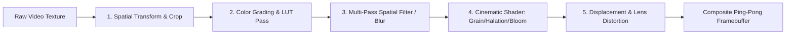

# FrameForge Studio: Effects & Shader Architecture Specification

**Document Version:** 1.0.0  
**Classification:** GPU Rendering & VFX Engineering Specification  

---

## 1. Effects Pipeline Architecture Overview

The FrameForge Studio Effects System is a high-performance, modular, GPU-accelerated processing pipeline. Effects are **not** simulated using CSS styling or rudimentary DOM tricks. Every effect executes as a mathematically verified GPU shader pass or compositing operation operating on IEEE 754 floating-point color buffers.



---

## 2. Mathematical Formulations & Shader Implementation Standards

### 2.1. Color Grading & Wheels (Lift, Gamma, Gain)
The 3-Way color grading operator applies non-linear lift, gamma, and gain adjustments across shadows, midtones, and highlights:

$$\text{Lifted}(C) = C \cdot (1.0 - \text{Lift}) + \text{Lift}$$
$$\text{Gained}(C) = \text{Lifted}(C) \cdot \text{Gain}$$
$$\text{Color}_{\text{graded}}(C) = \text{sign}(\text{Gained}(C)) \cdot |\text{Gained}(C)|^{\frac{1.0}{\text{Gamma}}}$$

Where $C \in [0.0, 1.0]^3$ represents linear RGB color values.

### 2.2. Cinematic Film Grain Synthesis
Real analog film grain exhibits non-uniform luminance response (most visible in mid-tones, compressed in deep blacks and specular highlights). We implement a pseudo-random procedural noise function with luminance weighting:

```glsl
// GLSL Fragment Shader snippet for Film Grain
precision highp float;
uniform sampler2D u_texture;
uniform float u_time;
uniform float u_grainIntensity; // Default: 0.15
uniform float u_grainSize;      // Default: 1.5
varying vec2 v_uv;

float hash(vec2 p) {
    vec3 p3  = fract(vec3(p.xyx) * 0.1031);
    p3 += dot(p3, p3.yzx + 33.33);
    return fract((p3.x + p3.y) * p3.z);
}

void main() {
    vec4 color = texture2D(u_texture, v_uv);
    float luma = dot(color.rgb, vec3(0.2126, 0.7152, 0.0722));
    
    // Film grain response curve: peaks around 0.5 luma
    float grainMask = 1.0 - 4.0 * pow(luma - 0.5, 2.0);
    grainMask = clamp(grainMask, 0.1, 1.0);
    
    vec2 noiseCoord = (v_uv + vec2(u_time * 17.0, u_time * 43.0)) / u_grainSize;
    float noise = (hash(noiseCoord) * 2.0 - 1.0) * u_grainIntensity * grainMask;
    
    gl_FragColor = vec4(clamp(color.rgb + vec3(noise), 0.0, 1.0), color.a);
}
```

### 2.3. Halation (Film Edge Bleed)
Halation occurs in analog film when intense light penetrates the emulsion and reflects off the backing layer, creating an organic warm/red halo around high-contrast edges:
1. **Luma Threshold Isolation:** Filter out pixels where luminance $L > T_{\text{threshold}}$.
2. **Radial Red-Shifted Blur:** Downscale threshold buffer and execute a 2-pass separable Gaussian blur biased heavily towards the red and orange spectrum.
3. **Additive Blend:** Re-composite the blurred red halo over the source frame using Screen/Additive blending.

### 2.4. Dual-Pass Separable Gaussian Blur
To maintain a strict 60fps rendering budget, two-dimensional Gaussian blurs are never calculated as an $O(N^2)$ convolution kernel. Instead, they are split into separable horizontal and vertical $O(2N)$ passes using pre-computed binomial coefficients:

$$G(x, y) = \frac{1}{2\pi\sigma^2} e^{-\frac{x^2+y^2}{2\sigma^2}} = \left( \frac{1}{\sqrt{2\pi}\sigma} e^{-\frac{x^2}{2\sigma^2}} \right) \cdot \left( \frac{1}{\sqrt{2\pi}\sigma} e^{-\frac{y^2}{2\sigma^2}} \right)$$

---

## 3. Comprehensive Effect Catalog

| Effect Category | Effect Name | Primary Parameters | Keyframe Support | Shader Implementation |
| :--- | :--- | :--- | :--- | :--- |
| **Transform** | Basic Transform | Position (X, Y), Scale (X, Y, Uniform), Rotation (deg), Anchor (X, Y), Opacity (%) | Yes (Cubic Bézier) | Matrix3x3 Affine Transformation |
| **Transform** | Crop & Feather | Left, Top, Right, Bottom, Feather Radius | Yes | Signed Distance Field (SDF) Box Clip |
| **Transform** | Corner Pin / 3D Quad | Top-Left, Top-Right, Bottom-Right, Bottom-Left UV coords | Yes | Homography / Projective Matrix |
| **Color** | Basic Exposure & Temp | Exposure (EV), Contrast, Temperature (K), Tint, Highlights, Shadows | Yes | Analytic Kelvin Color Temp + Luma Matrix |
| **Color** | 3-Way Color Wheels | Lift (RGB), Gamma (RGB), Gain (RGB), Master Offsets | Yes | Non-linear 3-stage power functions |
| **Color** | HSL Secondary Qualifier | Target Hue, Hue Range, Saturation Range, Luma Range, Hue Shift | Yes | RGB $\leftrightarrow$ HSV color space conversion |
| **Color** | 3D LUT Applicator | LUT Texture (`.cube`), Mix (0.0 to 1.0) | Yes | Tetrahedral 3D Texture Interpolation |
| **Blur** | Gaussian Blur | Radius (px), Quality (Passes), Direction (Horizontal/Vertical) | Yes | 2-Pass Separable Downsampled Kernel |
| **Blur** | Directional Motion Blur | Angle (deg), Distance (px), Samples (8-32) | Yes | Linear Trajectory Jitter Accumulator |
| **Blur** | Radial / Zoom Blur | Center Point (X, Y), Intensity, Spiral Angle | Yes | Radial Raymarch Convolution |
| **Cinematic** | 35mm / 16mm Film Grain | Size, Intensity, Roughness, Luma Masking | Yes | Procedural PRNG hash with temporal offset |
| **Cinematic** | Film Halation | Threshold, Radius, Color Tint, Blend Mode | Yes | Downsampled Red-Biased Threshold Glow |
| **Cinematic** | Anamorphic Lens Flare | Threshold, Streak Length, Flare Color, Anamorphic Ratio | Yes | Horizontal 1D Stretch & Chromatic Bleed |
| **Cinematic** | Chromatic Aberration | Radial Offset (px), Angle (deg), Channel Spread | Yes | Separated R/G/B UV sampling |
| **Cinematic** | Organic Vignette | Amount, Midpoint, Feather, Roundness | Yes | Elliptical Falloff Distance Function |
| **Distortion** | Optical Lens Distortion | Barrel/Pincushion (-1.0 to 1.0), Center, Scale | Yes | Brown-Conrady Polynomial Distortion Model |
| **Distortion** | Digital Glitch | Block Noise Frequency, RGB Split, Scanlines, Slices | Yes | Temporal stepped pseudo-random slicing |
| **Distortion** | Wave / Liquid Warp | Amplitude, Frequency, Phase, Speed | Yes | Multi-octave sinusoidal coordinate offset |

---

## 4. Keyframing & Parameter Automation Architecture

Every effect parameter conforms to the `IAnimatableProperty<T>` schema:

```typescript
export type InterpolationMode = 'linear' | 'hold' | 'bezier' | 'hermite' | 'spring';

export interface Keyframe<T = number> {
  id: string;
  time: RationalTime;
  value: T;
  interpolation: InterpolationMode;
  inHandle?: { x: number; y: number };  // Tangent coordinates [-1.0, 1.0]
  outHandle?: { x: number; y: number };
}

export interface AnimatableProperty<T = number> {
  id: string;
  name: string;
  defaultValue: T;
  currentValue: T;
  isKeyframed: boolean;
  keyframes: Keyframe<T>[];
  evaluateAt(time: RationalTime): T;
}
```

Evaluating a keyframed value at arbitrary playhead time $t$ executes a binary search over $O(\log K)$ sorted keyframe boundaries followed by Hermite/Cubic-Bézier spline root solving.
