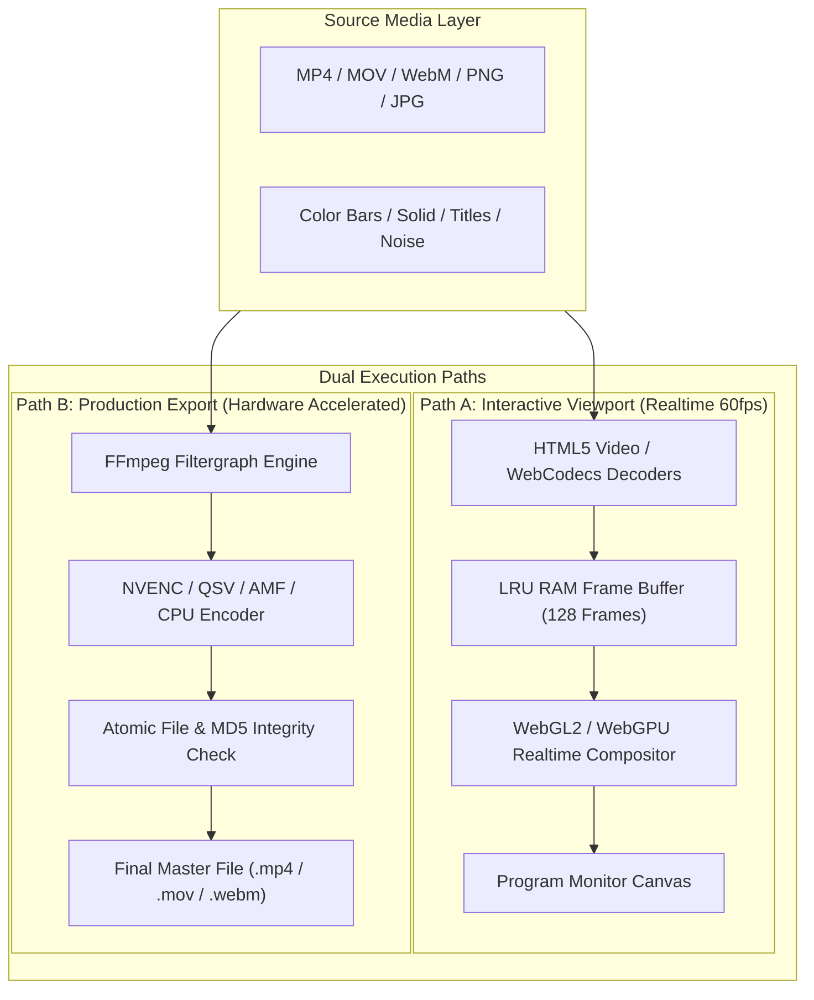

# FrameForge Studio: Rendering Pipeline & Export Architecture

**Document Version:** 1.0.0  
**Classification:** Core Systems Specification  

---

## 1. Dual-Path Render Pipeline Architecture

To achieve zero stutter during interactive editing while guaranteeing bit-for-bit frame accuracy during final export, FrameForge Studio implements a strict **Dual-Path Render Architecture**:

---

## 2. Multi-Track Layer Compositing & Alpha Mathematics

At any given playhead position $t_{\text{playhead}}$, the compositing engine calculates an ordered stack of active visual clips across all tracks ($V_0, V_1, \dots, V_{N-1}$):

1. **Clip Intersection Query:**
   $$\text{ActiveClips}(t) = \{ C \in \text{Tracks} \mid C.\text{timelineRange}.\text{start} \le t < C.\text{timelineRange}.\text{start} + C.\text{timelineRange}.\text{duration} \}$$

2. **Source In-Point Remapping:**
   $$t_{\text{source}} = C.\text{sourceRange}.\text{start} + (t - C.\text{timelineRange}.\text{start}) \cdot C.\text{speed}$$

3. **Alpha Pre-Multiplication:**
   To eliminate dark fringing along semi-transparent feathered edges and text borders, all color calculations are performed in **pre-multiplied alpha**:
   $$C_{\text{premult}} = (R \cdot A, G \cdot A, B \cdot A, A)$$

4. **Porter-Duff "Over" Compositing Operator:**
   Given background layer $B$ and foreground layer $A$:
   $$\text{Color}_{\text{out}} = A_{\text{color}} + B_{\text{color}} \cdot (1.0 - A_{\alpha})$$
   $$\alpha_{\text{out}} = A_{\alpha} + B_{\alpha} \cdot (1.0 - A_{\alpha})$$

5. **Blend Mode Math:**
   - **Multiply:** $f(A, B) = A \cdot B$
   - **Screen:** $f(A, B) = 1.0 - (1.0 - A) \cdot (1.0 - B)$
   - **Overlay:**
     $$f(A, B) = \begin{cases} 2AB & B < 0.5 \\ 1.0 - 2(1.0 - A)(1.0 - B) & B \ge 0.5 \end{cases}$$

---

## 3. Color Space Management & Linearity

Digital video sources are routinely encoded in gamma-compressed color spaces (sRGB with $\gamma \approx 2.2$ or Rec.709 with piecewise transfer functions).
- **Linear Compositing Rule:** Physical light blends linearly. Compositing gamma-encoded pixels directly leads to artificial darkening around blurred edges and incorrect optical cross-fades.
- **Color Pipeline:**
  1. Input Video Texture (Rec.709 / sRGB Transfer Function)
  2. Degamma Shader Pass $\rightarrow$ Linear RGB Floating Point Buffer
  3. Transform, Blending, Color Grading, and Blur in Linear Light
  4. Regamma Shader Pass $\rightarrow$ Display Target (sRGB / Display P3 / Rec.709)

---

## 4. Hardware-Accelerated Production Export Engine

When initiating a final master render:
1. **Dynamic Filtergraph Synthesis:**
   The engine analyzes the timeline structure and serializes a high-performance FFmpeg `-filter_complex` graph.
2. **Hardware Encoder Selection Matrix:**
   FrameForge Studio probes the operating system GPU drivers:
   - **NVIDIA GPU:** Selects `h264_nvenc` or `hevc_nvenc` with `-preset p6 -tune hq -rc vbr -cq 18`.
   - **Intel CPU/GPU:** Selects `h264_qsv` or `hevc_qsv` with `-preset veryslow -global_quality 20`.
   - **AMD Radeon:** Selects `h264_amf` or `hevc_amf`.
   - **Fallback (CPU):** Selects `libx264` or `libx265` with `-preset medium -crf 18`.
3. **Audio-Video Synchronization:**
   Audio tracks are normalized, gain-automated, and mixed via FFmpeg `amix=inputs=M:dropout_transition=0` with `aresample=48000:async=1` to guarantee zero audio drift across multi-hour timelines.
4. **Export Integrity Gate:**
   Before marking any export as complete, the output file is inspected via `ffprobe` to verify:
   - Valid video and audio stream headers.
   - Non-zero byte length.
   - Total duration matches timeline sequence duration within $\pm 1$ frame tolerance.

