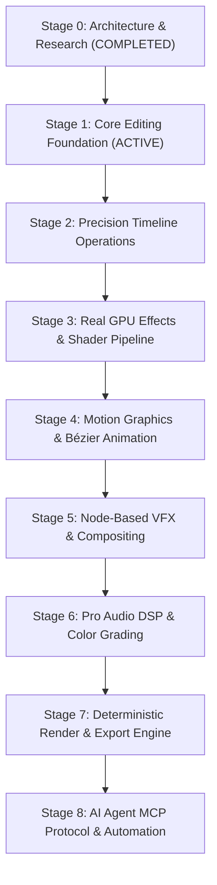

# FrameForge Studio: Engineering Roadmap & Milestones

**Version:** 1.0.0  
**Current Phase:** Stage 0 Complete & Stage 1 Implementation  

---

## Stage Progression & Gate Criteria

Each stage requires a complete build verification, automated unit and integration tests passing, and zero regressions before progressing to the subsequent milestone.

---

### Stage 0: Research, Architecture & Technical Design (COMPLETED)
- [x] Comprehensive review of open-source video editing engines (OTIO, MLT, Natron, Remotion, FFmpeg, WebGPU).
- [x] Legal & dependency license audit (Apache 2.0 selection, LGPL/GPL segregation).
- [x] Technical specification documents: `ARCHITECTURE.md`, `TECH_STACK.md`, `DEPENDENCY_AUDIT.md`, `ROADMAP.md`, `EFFECTS_SYSTEM.md`, `RENDERING_PIPELINE.md`.
- [x] Repository initialization, monorepo architecture layout, tooling setup.

---

### Stage 1: Real Editing Foundation (ACTIVE)
- [x] **Monorepo Structure:** Layout of `apps/desktop`, `packages/core`, `packages/engine`, `packages/audio`, `packages/mcp`.
- [x] **Core Timeline Data Model:**
  - Rational time arithmetic engine (`RationalTime`, `TimeRange`, frame rates: 23.976, 24, 25, 29.97, 30, 50, 59.94, 60 fps).
  - Multitrack sequence data structures (Video tracks, Audio tracks, Overlay tracks).
  - Clip placement, source in/out points, track indexing.
- [x] **Desktop Shell Application:**
  - Electron + Vite + React 19 + TypeScript + Tailwind CSS integration.
  - Native windowing, menu bars, responsive pane splitter layout.
  - Secure IPC bridge for file dialogues, media metadata probing, and local file access.
- [x] **Media Ingestion & Asset Library:**
  - Drag-and-drop file import (MP4, MOV, WebM, PNG, JPG, WAV, MP3).
  - Video stream inspection via FFprobe/HTML5 metadata (resolution, frame rate, duration, codec).
  - Thumbnail generator and media cache.
- [x] **Dual Viewport Monitor:**
  - Source Monitor (preview raw media clip, set in/out points `[I]` / `[O]`).
  - Program Monitor (realtime composited sequence playback with playhead timecode indicator).
- [x] **Multitrack Interactive Timeline:**
  - High-frequency virtualized canvas / DOM rendering.
  - Interactive playhead scrubbing at 60fps.
  - Zoom (`Ctrl + Wheel` / Slider), horizontal pan, track expand/collapse.
  - Clip dragging between tracks, position snapping, duration stretching.

---

### Stage 2: Precision Timeline Operations & History Engine
- [ ] **Editing Tools Matrix:**
  - Selection Tool `[V]`: Move, select, group clips.
  - Razor / Blade Tool `[C]`: Split clip at playhead or cursor.
  - Ripple Edit Tool `[B]`: Trim clip and automatically shift downstream clips.
  - Roll Edit Tool `[N]`: Adjust cut point between adjacent clips without altering sequence duration.
  - Slip Tool `[Y]`: Adjust in/out points of media content within fixed timeline boundaries.
  - Slide Tool `[U]`: Shift clip position while adjusting neighbors' in/out points.
- [ ] **Snapping Engine:**
  - Magnetic snapping to clip boundaries, playhead, sequence markers, and track in/out points.
  - Configurable snapping threshold in pixels and frames.
- [ ] **Command Bus & Invertible History:**
  - Atomic `ICommand` implementation for all timeline mutations.
  - Infinite non-destructive Undo `[Ctrl+Z]` and Redo `[Ctrl+Shift+Z]`.
  - Transaction rollback on unexpected errors.
- [ ] **Persistence & Autosave:**
  - SQLite transaction journal for zero-loss recovery on unexpected shutdown.
  - Portable `.frameforge` project format (zipped JSON manifest + SQLite state).

---

### Stage 3: Real GPU Effects & Shader Pipeline
- [ ] **Compositing Render Graph:**
  - Off-screen multi-buffer ping-pong render targets.
  - WebGL2 / WebGPU fragment shader pipeline.
- [ ] **Standard Transform Engine:**
  - Sub-pixel positioning, uniform/non-uniform scaling, rotation around customizable anchor points.
  - Alpha transparency and standard blend modes (Normal, Multiply, Screen, Overlay, Darken, Lighten, Color Dodge).
- [ ] **Cinematic Shader Suite:**
  - Real film grain simulation with customizable grain size, roughness, and luminance response.
  - Halation (red-edge glow on high-luminance borders).
  - Bloom & Lens Flares with threshold and radius control.
  - Chromatic Aberration (radial RGB channel separation).
  - Vignette with softness, roundness, and feathering.
- [ ] **Inspector Panel:**
  - Real-time parameter controls (sliders, numeric inputs, color pickers, reset buttons).

---

### Stage 4: Motion Graphics & Bézier Animation
- [ ] **Keyframe Animation Engine:**
  - Keyframable parameters for every effect, transform, and audio control.
  - Interpolation modes: Linear, Constant (Hold), Bézier Spline, Hermite Spline, Spring physics.
- [ ] **Visual Curve Editor:**
  - Dual-handle cubic Bézier graph view for interactive curve shaping.
- [ ] **Kinetic Typography Workspace:**
  - Rich text formatting (fonts, kerning, line-height, letter-spacing, alignment).
  - Per-character text animations (fade, slide, typewriter, tracking expand).
- [ ] **Vector Shapes & Overlays:**
  - Procedural rectangles, circles, paths, arrows, lower thirds, callouts, and animated data cards.

---

### Stage 5: Node-Based VFX & Compositing Workspace
- [ ] **Dedicated VFX Tab:**
  - Flowchart / DAG node editor for complex multi-layer compositing.
  - Node types: Media Input, Chroma Keyer (Green/Blue screen), Luma Keyer, Math/Blend, Mask Generator, Transform, Output.
- [ ] **Chroma Keying Engine:**
  - Despill algorithm, edge feathering, matte cleanup (choke, blur, contrast).
- [ ] **Masking & Rotoscoping:**
  - Bézier path masking with animated control vertices and feathering.

---

### Stage 6: Professional Audio DSP & Color Grading
- [ ] **Multitrack Audio Mixer:**
  - Dedicated channel strips with peak volume meters (dBFS), solo, mute, faders, and stereo pan.
  - Parametric 4-Band Equalizer with interactive frequency response curves.
  - Dynamics Compressor with threshold, ratio, attack, release, and make-up gain.
- [ ] **Cinematic Color Grading Suite:**
  - 3-Way Color Wheels (Lift, Gamma, Gain / Shadows, Midtones, Highlights) with master luminance sliders.
  - Curves: Master RGB curve, individual Red/Green/Blue curves, Hue vs Hue, Hue vs Saturation.
  - 3D LUT Ingestion (`.cube` format parser and 3D texture sampler).

---

### Stage 7: Deterministic Render & Production Export
- [ ] **FFmpeg Production Exporter:**
  - Multi-threaded hardware-accelerated pipeline (NVENC H.264/HEVC, Intel QuickSync, AMD AMF, CPU x264/x265).
  - Frame-accurate video and audio muxing with exact sample rate alignment (48 kHz).
  - Presets: YouTube 4K/1080p, ProRes 422 Master, Instagram/TikTok 9:16 Vertical, Discord WebM.
- [ ] **Render Queue & Verification:**
  - Background asynchronous queue with real-time percentage, elapsed time, ETA, and frame counter.
  - Post-render checksum and file verification before notifying completion.

---

### Stage 8: AI Agent Integration & MCP Server
- [ ] **Native Model Context Protocol (MCP) Server:**
  - Expose JSON-RPC tools for project inspection, clip insertion, split, trim, effect application, and rendering.
  - Strict sandboxing: commands route through the identical validated `ICommand` bus as human input.
- [ ] **Script-to-Visual Alignment Engine:**
  - Audio transcript ingestion with word-level timestamps.
  - Automatic B-roll, lower-third, and citation graphic placement synchronized to speech cadence.
